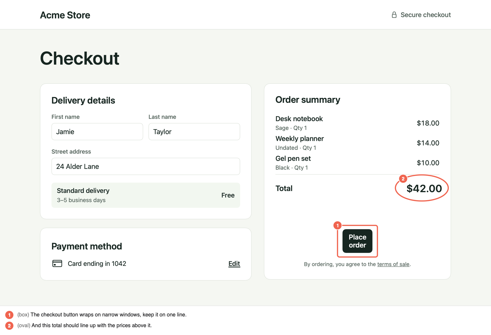

# Pilcrow ¶

**Point at it. Say it. Paste it.**

Pilcrow is a macOS menu-bar app for giving visual feedback to coding agents. Press ⌥D, hold ⇧ and draw on any app while you talk, then press Esc. Your agent gets one message with three parts:
- what you said, split by numbered mark;
- a screenshot with your marks drawn in;
- a close-up of each mark.

The agent never has to guess which button you meant.

Pilcrow needs macOS 26 or later. There is no download yet, so you [build it from source](#install).

<p align="center">
  
</p>

## What your agent receives

Box the button while saying one thing, then circle the total while saying another. Press Esc, and this is on your clipboard (paths shortened):

```text
The checkout button [1] wraps on narrow windows, keep it on one line. And this total [2] should line up with the prices above it.

frame-1.png — Safari · "Checkout – Acme Store"
- [1] (box) "The checkout button wraps on narrow windows, keep it on one line." on "Place order" → mark-1.png (in frame-1.png)
- [2] (oval) "And this total should line up with the prices above it." on "$42.00" → mark-2.png (in frame-1.png)

Images (read these first):
~/Library/Application Support/Pilcrow/Outbox/…/frame-1.png
~/Library/Application Support/Pilcrow/Outbox/…/mark-1.png
~/Library/Application Support/Pilcrow/Outbox/…/mark-2.png
```

The PNGs are on the clipboard as files too. Terminal agents read the paths, and chat apps can attach the files. Each image also has the words printed under its badges.

- **Words go to the right mark.** Pilcrow matches on-device speech timing to when you drew each mark, so you can talk before, during or just after drawing.
- **Each mark gets context:** the app and window it was drawn on, and the text under it, read on your Mac.
- **Clear shapes are tidied.** Rough boxes, ovals and arrows become clean ones. A line from one mark to another becomes `(arrow from [1] to [2])`. Anything ambiguous keeps your ink.

## Install

You need macOS 26 or later and Xcode 26 or later, selected with `xcode-select`. Pilcrow is tested on Apple silicon. Signed downloads are tracked in [#1](https://github.com/umarali/pilcrow/issues/1).

```bash
git clone https://github.com/umarali/pilcrow.git
cd pilcrow
./tools/build-app.sh
ditto build/Pilcrow.app /Applications/Pilcrow.app
open /Applications/Pilcrow.app
```

Without a signing identity, the build is signed ad hoc, and macOS may ask for Screen Recording again after each rebuild. [Building](docs/building.md#local-signing) shows how to sign with a stable identity.

## First capture

1. Press **⌥D**. The first time, Settings opens: click **Open Settings ↗** on the Screen Recording card and allow Pilcrow. For voice, click **Turn On…** under Microphone.
2. Press **⌥D** again. Hold **⇧** and draw while you talk; ⇧-click drops a pin. Release ⇧ to use the app underneath. **⌘Z** undoes the last mark.
3. Press **Esc**, then **⌘V** in your agent. Click the receipt that appears to review the crops, or to send the capture to Claude Code or Codex in Terminal.

The [user guide](docs/using-pilcrow.md) covers shapes, arrows, voice and Review.

## Let your agent fetch captures

Instead of pasting, you can let an agent fetch captures itself through Pilcrow's local, read-only MCP server. In Settings, under **Let your agent fetch captures**, click **Claude Code** or **Codex** to copy a setup command, and run it once. Then ask: *"Look at my latest Pilcrow capture and fix what I marked."*

A connected agent can read any capture from the last 24 hours, from any project, without you pasting anything. [Agents](docs/agents.md) has the commands and tools.

## Privacy

Pilcrow runs on your Mac. It has no servers, accounts or analytics. Speech, text recognition and window lookup all run locally.

- **Permissions.** Screen Recording is required, and is used for still screenshots, never video. The microphone is optional and used only during a session. Audio is never saved.
- **Where captures go.** They stay in a private local folder for about 24 hours. A capture leaves your Mac only when you paste it or send it from Review, or when an MCP agent you connected fetches it. While a capture is on the clipboard, any app that reads the clipboard can see it.
- **What's in them.** Screenshots show the whole display, and the message includes window titles and on-screen text.

[Privacy](docs/privacy.md) has the details, including the clipboard and when old captures are deleted.

## Status

Pilcrow is early. Marks, shapes, word alignment, export and MCP have unit tests. Drawing, capture and export have been tested on a real Mac. Less tested on real hardware:
- voice timing;
- pasting into different agents;
- Review sends;
- some multi-display setups.

See [#2](https://github.com/umarali/pilcrow/issues/2) and the [open issues](https://github.com/umarali/pilcrow/issues).

## Documentation

- [User guide](docs/using-pilcrow.md): marks, shapes, arrows, voice, Review, Settings
- [Agents](docs/agents.md): message format, pasting, Terminal sends, MCP
- [Privacy](docs/privacy.md): permissions, storage, what leaves your Mac
- [Contributing](CONTRIBUTING.md), [Architecture](docs/architecture.md), [Building](docs/building.md), [Manual testing](docs/manual-testing.md)
- [Decision log](docs/decisions.md): why Pilcrow works the way it does

## Related work

[Scrawl](https://github.com/kitlangton/scrawl) records your screen, voice and ink, and gives an agent a contact sheet of keyframes. Pilcrow takes still screenshots instead, and ties each instruction to a numbered mark. Several of Pilcrow's choices about permissions, packaging and image legibility follow lessons from Scrawl's repository.

## License

[MIT](LICENSE). A pilcrow (¶) is the proofreader's paragraph mark.
