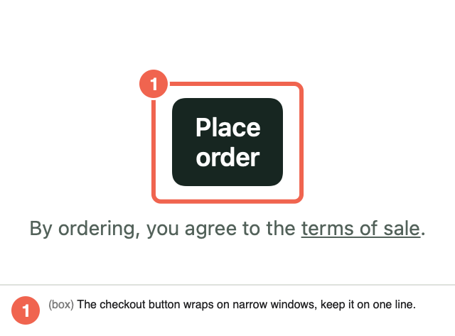

# Agents

Pilcrow gives your agent the same capture in three ways: pasting it, sending it from Review, or letting the agent fetch it over MCP. Every capture is one message plus PNG files.

## The message

```text
The checkout button [1] wraps on narrow windows, keep it on one line. And this total [2] should line up with the prices above it.

frame-1.png — Safari · "Checkout – Acme Store"
- [1] (box) "The checkout button wraps on narrow windows, keep it on one line." on "Place order" → mark-1.png (in frame-1.png)
- [2] (oval) "And this total should line up with the prices above it." on "$42.00" → mark-2.png (in frame-1.png)
```

The message has these parts:

1. **The transcript.** Everything you said, with `[n]` where each mark was drawn.
2. **A frame header.** `frame-1.png — App · "Window title"` names the app and window under the first mark on that screenshot. It is left out if Pilcrow couldn't tell.
3. **One line per mark.** Each line has:
   - the number;
   - the kind: `point`, `box`, `oval`, `circle`, `area` or an arrow with its links, such as `arrow from [1] to [2]`;
   - the words for that mark;
   - `on "…"`, the on-screen text under the mark, read with Vision on your Mac;
   - the crop and the frame it came from.

The on-screen text is left out when Pilcrow can't read a confident label quickly. A mark with no words still gets its line. Plain ink, such as an underline, has no kind label.

### Images



| File | Contents |
|---|---|
| `frame-N.png` | The full screenshot of one display, with all marks and badges drawn in. If any mark on it has words, a panel underneath lists them. |
| `mark-N.png` | A close-up around mark N, with its words in a strip underneath |

Images are at most 1,600 px on a side and 1.56 megapixels, so they fit agents' image limits, and badges stay at least 24 px tall. If a frame has too many spoken marks to fit, the panel is left out and the words stay in each crop. Long captions are cut short with a pointer to the full words in the message.

If a screenshot or file fails, the mark's line keeps its planned file name with a reason such as `(screenshot not available)`, and only files that were saved are listed under `Images`. A capture with words but no marks has no images.

## Pasting

Finish puts the message on the clipboard, followed by `Images (read these first):` and the absolute path of each PNG. Each PNG is also on the clipboard as a file. What you get depends on where you paste:

- **Terminal agents** such as Claude Code and Codex get the text, and read the images from the paths.
- **Chat apps and IDE agents** may attach the files, use the text, or both.
- **Image-only targets** still get the instructions printed under each badge, as long as the mark has words.

The paths point to your Mac, so an agent running elsewhere can't open them. Paste into an agent running on this Mac, or one that attaches the files.

## Sending from Review

Review's **Claude Code** and **Codex** buttons open Terminal.app and start the agent in a project folder you choose once per agent. The message text is passed as the prompt:

- `claude -- "<message>"`
- `codex -i <image>,<image> -- "<message>"`. The images are passed as one comma-separated argument, and left out if any path contains a comma. The message still lists the paths.

Pilcrow finds `claude` or `codex` on your login shell's `PATH` and runs that executable directly, so aliases and shell functions are skipped. If the agent isn't found, its button is disabled. Pilcrow can only tell that Terminal accepted the command, not whether the agent read the message. Other terminals aren't supported yet ([#7](https://github.com/umarali/pilcrow/issues/7)).

## MCP

`pilcrow-mcp` is a small read-only [MCP](https://modelcontextprotocol.io) server inside the app bundle. Once it's set up, ask your agent to "look at my latest Pilcrow capture" instead of pasting.

### Setup

Settings → **Let your agent fetch captures** → **Copy for Claude Code** or **Codex** copies the command with the real path to your copy of Pilcrow. Run it once in a terminal:

```bash
claude mcp add --scope user --transport stdio pilcrow -- '/Applications/Pilcrow.app/Contents/MacOS/pilcrow-mcp'
codex mcp add pilcrow -- '/Applications/Pilcrow.app/Contents/MacOS/pilcrow-mcp'
```

User scope makes Pilcrow available in every project. Start a new agent session afterwards so it picks up the server. Any MCP client that can launch a stdio server can use the same executable.

### Tools

| Tool | Input | Returns |
|---|---|---|
| `pilcrow_latest` | none | The newest capture: the message, then crops in mark order, then frames |
| `pilcrow_list` | none | Up to 20 recent captures, each with its id, time, mark count and file names |
| `pilcrow_get` | `id`, optional `mark` | One capture. With `mark`, only that mark's line, its frame header and its crop. |

When there are no captures, `pilcrow_latest` and `pilcrow_list` say "No Pilcrow captures in the last 24 hours." `pilcrow_get` returns an error for an unknown id or mark.

### What the server can see

- **Recent captures only.** It serves outbox captures from the last 24 hours, from every project, with no further confirmation. Discarded and cleared captures are gone.
- **Read-only and local.** It never writes, captures the screen or uses the network.
- **Strict about files.** It serves only `frame-N.png` and `mark-N.png` files you own, with a PNG signature, from capture folders that others can't write to and whose names match their manifest. Anything else is skipped. `strokes.json` and `debug/` are never served.
- **Bounded responses.** One response carries at most 10,000,000 bytes of base64 image data, crops first. Images left out are named with their paths.
- **Custom location.** Set `PILCROW_OUTBOX_DIR` in the server's environment to read a different outbox.

The server speaks newline-delimited JSON-RPC over stdio and accepts protocol versions 2025-11-25, 2025-06-18, 2025-03-26 and 2024-11-05. The source is in [`Sources/PilcrowMCP`](../Sources/PilcrowMCP).

## Capture folder

Each capture is a folder in `~/Library/Application Support/Pilcrow/Outbox/<id>/`:

| File | Purpose |
|---|---|
| `message-for-agent.md` | The message with image paths, used for Terminal sends. It ends with a note that the images contain each mark's words. |
| `message.md` | The message without image paths |
| `frame-N.png`, `mark-N.png` | The images |
| `manifest.json` | Message text, attachment list, frame context and on-screen text. Written last; a capture with a manifest is available over MCP. |
| `strokes.json` | Raw stroke points for tuning shape recognition. Never sent. |
| `debug/voice.json` | Recognized words and timings for tuning voice alignment. Never sent. |
| `send.command` | The script a Review send ran, if any |

Folders are private (mode 0700). Captures older than 24 hours are deleted when Pilcrow launches, after Finish and before a Review send. See [Privacy](privacy.md#where-its-stored).
