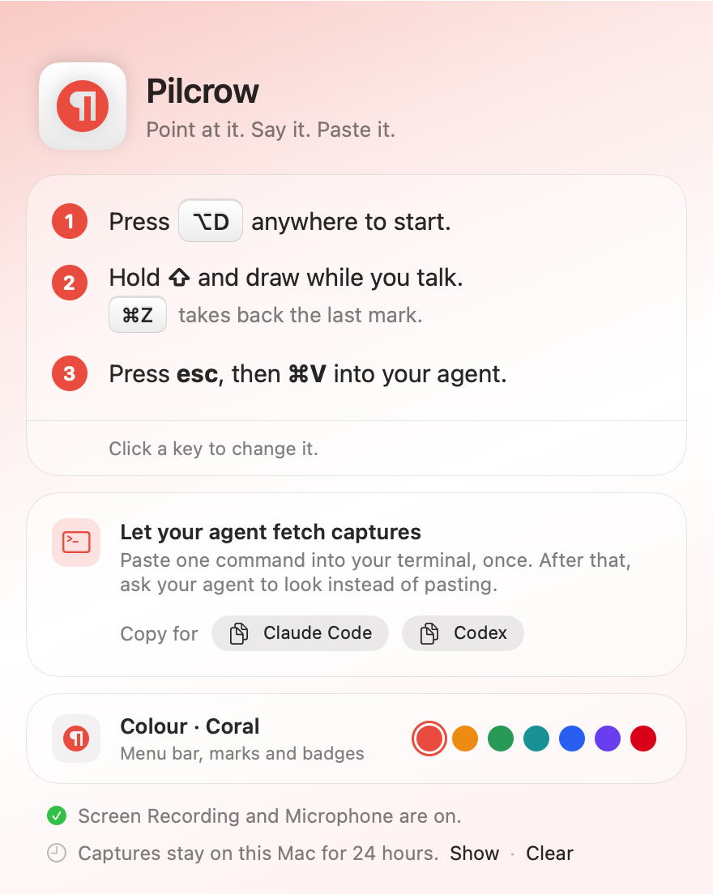

# Using Pilcrow

Pilcrow lives in the menu bar as ¶. Its menu has **Start annotating** (**Finish annotating** during a session), **Review last capture…**, **Settings…** (⌘,) and **Quit Pilcrow**. Opening Pilcrow again while it is idle shows Settings.

## A session

1. **Start** with ⌥D. The first time, Settings opens instead: click **Open Settings ↗** on the red Screen Recording card, allow Pilcrow, then press ⌥D again. To use voice, click **Turn On…** under Microphone once (see [Talking](#talking)).
2. **Hold ⇧ to draw.** While ⇧ is held, the screen belongs to Pilcrow, and a ring appears around the pointer after a moment. Release ⇧ and the app underneath works normally. Typing capitals doesn't interrupt you, because the overlay only reacts to ⇧ held on its own.
3. **Finish** with Esc, ⌥D again, or by clicking the small **esc** pill. Everything is copied in one go, and a receipt appears at the bottom right. Press ⌘V in your agent.

During a session Pilcrow takes Esc, so Esc finishes the session instead of reaching the app underneath. While Pilcrow is running, ⌥D belongs to Pilcrow, so it no longer types ∂. Change it in Settings if you need that character.

### Screenshots

Pilcrow takes a still screenshot of a display the moment you start your first mark on it. Marks are drawn onto that screenshot, not onto a live recording. If you click or scroll the app underneath, your next mark takes a fresh screenshot. Typing alone doesn't.

Each display gets its own screenshot, so one session can cover several displays. Each screenshot becomes a `frame-N.png`, and each mark also gets a close-up crop, `mark-N.png`.

## Marks

Every mark gets a number badge in your Pilcrow colour. A finished mark's number is never reused in that session, even after undo, so "[3]" always means the same thing.

| Draw | You get |
|---|---|
| ⇧-click | A **point**: a pin on one spot |
| A rough rectangle | A tidy **box** |
| A rough circle or ellipse | A tidy **oval** or **circle** |
| Any other closed loop | An **area**: your ink, as drawn |
| A line | Your ink, or an **arrow** (see below) |

Pilcrow tidies a shape only when it is confident. If it isn't sure, your ink stays as drawn. A loop with a long tail also keeps its ink.

### Arrows

A fairly straight line becomes an arrow when it starts or ends at another mark, or when you draw a head on it.

- **Linking.** Start or end the line on a pin or area, or close to one. The message then says `(arrow from [1] to [2])`, `(arrow pointing at [2])` or `(arrow starting at [1])`. The tip may stop short of its target. A mark you draw later can also complete the link.
- **Heads.** Draw the head in the same stroke, by flicking back at the tip. Or add it afterwards, within 3 seconds, as a separate V or two short barbs. A single short barb also works, but only at the end where you lifted the pen. A head drawn at the starting end turns the arrow around.

### Undo

⌘Z removes your last mark since you last clicked or scrolled the app underneath. If that mark was a head added to an arrow, ⌘Z removes the head and restores the line. If the head didn't change the line, ⌘Z removes the arrow as well. Pilcrow only takes ⌘Z while there is something to undo. Otherwise ⌘Z goes to the app underneath.

## Talking

Turn voice on in Settings with **Turn On…** under Microphone. Pilcrow asks for microphone access and downloads Apple's on-device speech model if needed. After that, voice starts with every session, and the pill shows a level dot. Transcription runs on your Mac, in your system language if Apple supports it and US English otherwise. Pilcrow never saves audio.

Talk naturally, and Pilcrow assigns your words to marks by timing:

- **Speak while you draw.** The words you're saying when the pen goes down belong to that mark. "Move this [1] over here [2]" splits into two instructions.
- **Speak just before or after.** A sentence you finish shortly before drawing, or start just after, still goes to that mark.
- **One sentence, several marks.** Draw three boxes in quick succession, then straight away say "These three should be the same size." Each box gets the sentence.
- **Pauses are fine.** A short thinking pause inside a sentence keeps the sentence together.

The message also keeps your full transcript, with `[n]` where each mark was drawn. In English, the per-mark lines drop fillers like "um" and quick repeats like "this, this button". A capture with words but no marks is sent as words only.

Without voice, you still get numbered marks, screenshots, crops and the on-screen text under each mark. Type your instructions in the agent after pasting.

## After Finish

The receipt shows a thumbnail and **Copied · ⌘V**. It fades after about five seconds, and hovering keeps it open. It never takes focus, so you can press ⌘V straight away.

Click the receipt, or choose **Review last capture…** from the menu, to open **Review**. It shows each numbered crop with its words, and has these actions:

| Action | What it does |
|---|---|
| **Copy** | Copies the capture again |
| **Claude Code** / **Codex** | Opens Terminal and starts that agent in your project with the capture. The first time, Pilcrow asks which project folder. The chevron next to the button changes it. |
| **Show in Finder** | Reveals the capture folder |
| **Discard** | Deletes the capture. It also clears the clipboard, unless you have copied something else since. |

Esc or ⌘W closes Review and hides Pilcrow. Review only holds the last capture since Pilcrow launched. Older captures are in the outbox folder.

## Settings

- **Shortcuts.** Click a keycap to record a new one. The defaults are ⌥D to start and finish, and ⌘Z to undo. Start won't accept common app and terminal commands such as ⌘C or ⌃C. With a non-US keyboard layout, the defaults follow the D and Z keys on your layout.
- **Agent setup.** Copy the one-line command that lets Claude Code or Codex fetch captures over MCP. See [Agents](agents.md).
- **Colour.** Choose from seven colours for ink, badges and the active menu bar icon. Ink keeps a thin white halo so it stays readable on any background.
- **Permissions.** When Screen Recording or the microphone is off, a card above the steps shows a button to fix it. When both are on, a green check shows at the bottom.
- **Captures.** **Show** opens the outbox folder. **Clear** deletes every capture now, but leaves the clipboard alone.

## Troubleshooting

- **Pilcrow asks for Screen Recording after every rebuild.** The build is signed ad hoc. Sign it with a stable identity, as described in [Building](building.md#local-signing).
- **Settings still says Screen Recording is off after you turned it on.** macOS sometimes applies the change only after a restart. Use the reopen option Pilcrow offers.
- **Your shape wasn't tidied.** That is deliberate when Pilcrow isn't sure. If you think it should have been, add the capture's `strokes.json` to [#3](https://github.com/umarali/pilcrow/issues/3). It holds only stroke points and timing.
- **Words went to the wrong mark.** Draw as you say the key word, or say the sentence just before you draw. To help tune the timing, add `debug/voice.json` to [#4](https://github.com/umarali/pilcrow/issues/4). It contains your recognized words, so reproduce the problem with words you're happy to share.
